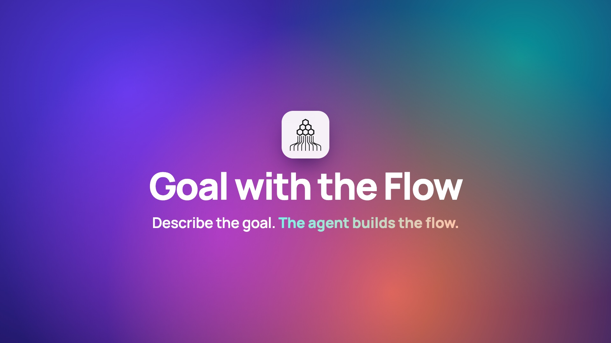

# Goal with the Flow

Describe the goal. The agent builds the flow.

Goal with the Flow connects your team's goals to the AI agent workflows that keep them on track. You describe what good looks like in plain language, and the agent drafts the workflow for you, so you never start from a blank canvas. When a goal like *Keep product delivery on track* slips, its agents show you which meeting action items are stuck, suggest an owner for each with evidence from the conversation, and ask you before acting when they aren't sure. You resolve the items from one panel, then open the workflow on a visual canvas, run a test that highlights the failing step, and deploy a fix so the same problem doesn't happen again.

Built for the AI Design Makeathon, Track 1: Agentic Workflow.

## Demo video

[](media/demo.mp4)

[Watch the 23-second demo (MP4)](media/demo.mp4). The footage is the real app running its guided tour with synthetic demo data. The soundtrack is original, generated in code for this video.

## The problem

- **Goals slip quietly.** Commitments made in meetings ("someone should bump the rate limits before the load test") never get an owner, and nobody notices until a deadline passes.
- **Automation is either too hard to build or too risky to trust.** Workflow builders hand goal owners a blank canvas and a node library. Autonomous agents act without asking and lose people's trust the first time they get it wrong.
- **When automation breaks, nobody can tell where.** Items just stop moving, and finding the cause means digging through logs or asking whoever built the workflow.

## How it works

1. **Start from a goal.** On Home, describe the goal. It shows up as a goal card with its health and progress.
2. **See why it's at risk.** The goal page shows the progress drop and the supporting workflows behind it. *Action Item Tracking* is paused at step 3 because 3 action items have no confirmed owner.
3. **Resolve the items in the workflow.** The workflow canvas opens with a Cues-style panel on the right, with the newest card on top. Each stuck item shows the meeting quote, its source and due date, and the agent's suggested owner with its evidence:
   - **Assign** the suggestion, or pick someone else. The agent DMs them in Slack and waits for their reply.
   - **Approve & sync** an owner who hasn't confirmed yet.
   - **Send reminder** to someone who was mentioned but hasn't said yes.

   When all 3 are resolved, step 3 turns green and the goal recovers (72% → 81%).
4. **Stop it from happening again.** Click **Run test**. The path lights up step by step and stops at *Owner Found?*, which turns red because nothing handles low-confidence matches. A teal *Workflow change* card offers fixes. Hover to preview the steps a fix adds, then click one: *Send them to me to decide* or *Ask the suggested owner in Slack*.
5. **Test and deploy.** **Run test again**: every step goes green and **Deploy** turns on. Deploy makes the fix live.
6. **Keep editing.** Come back from the goal page, open **Add steps**, add a *Slack DM* to step 3, remove *You decide*, test, and deploy again. You can remove any step with the × on the node or **Remove step** in its panel.

A guided tour (numbered hints with a pulsing ring) walks testers through the whole path. Steps 1–3 are on Home and the goal page, 4–10 cover the first pass on the canvas, 11 is back on the goal page, and 12–16 are the edit pass. **Skip tour** hides it, and **Reset demo** in the top bar starts over.

## Design principles

- **Describe the goal, don't build the plumbing.** The agent drafts the workflow, so your work is judgment rather than wiring.
- **The agent asks when it's unsure.** Below the auto-assign threshold (90%), it pauses and shows its evidence instead of guessing.
- **Problems surface in context.** Stuck items appear next to the workflow that stalled them, and a test run points to the exact step.
- **Nothing goes live without you.** Fixes are previewed, tested and deployed by a person.

## Run it locally

No build step and no dependencies: it's plain HTML, CSS and JavaScript.

```sh
git clone https://github.com/bachludwig19/ai-design-makeathon.git
cd ai-design-makeathon
python3 -m http.server 8765
```

Open <http://localhost:8765/>. Use a local server rather than opening the files from disk, so the pages share demo state through `localStorage`.

## Project structure

| Path | What it is |
|---|---|
| `index.html` | Home: create a goal and see goal health |
| `goal.html` | Goal detail: progress, blockers, supporting workflows |
| `canvas.html` | The workflow page: action items to resolve, workflow canvas, test, deploy |
| `workflow.html` | Retired; redirects to `canvas.html` |
| `assets/data.js` | Shared synthetic dataset (`MF`) and demo state (`MFState`), so every screen agrees |
| `assets/tour.js` | Guided tour rules for each page |
| `assets/engine.js` | Agent engine (scripted by default) |
| `assets/nav.js`, `assets/settings.js` | Shared navigation, top bar, Reset demo |
| `assets/tokens.css`, `assets/brand.css`, `assets/app.css` | Design tokens and shared styles |

## Notes

- All data is synthetic: the meeting, people, confidence scores and Jira keys are made up. Slack replies are simulated, and nothing calls a real integration.
- The demo always runs the scripted agent. `assets/engine.js` can also call a real model (a local Ollama model, Anthropic or OpenAI), but the demo UI doesn't expose that setting.
- The prototype opens with the drafted workflow already on the canvas. It shows the "agent drafts the workflow from your goal" approach but doesn't generate the workflow live.
